## 안녕하세요, 프론트엔드 개발자 박태현입니다 👋

기능이 아무리 복잡해도 사용자는 그 복잡함을 느끼지 않아야 한다고 생각합니다. 
지금은 소프트웨어 마에스트로 17기에서 여행 앱 **TripPilot**의 프론트엔드를 맡아 App Store에 출시하고 운영하고 있습니다.

- 🎓 아주대학교 소프트웨어학과 · 2020.03 ~ 2027.02 (졸업 예정)
- 🚀 소프트웨어 마에스트로 17기 · 2026.04 ~ 2026.11
- 🏆 Google–아주대학교 AI융합 캡스톤디자인 대회 장려상 · 2025.12
- 📄 KCC 2025 학부생 논문 포스터 발표 · 2025.07

 

## 📌 Projects

| 기간 | 프로젝트 | 소개 · 담당 |
|:---:|---|---|
| 2025.03 ~ 06 | 📄 **[HART-Shortcut](https://github.com/Nyam2C/hart-shortcut)** | 이미지 생성 모델 HART에 1-step 확산 모델을 이어 붙여 생성 속도를 높이는 연구 (KCC 2025) **담당** 제1저자 · 모델 재현·비교, 두 모델 결합 |
| 2025.09 ~ 12 | 🧠 **[SyncNapse](https://github.com/CodeGachi/SyncNapse)** | 강의 자료·녹음·자막·손필기를 한곳에 모은 학습 플랫폼 **담당** 팀장 · 프론트엔드 |
| 2026.02 ~ 07 | 💹 **[FinClaw](https://github.com/Nyam2C/FinClaw)** | 혼자 읽고 감사할 수 있는 개인용 금융 AI 비서 **담당** 개인 프로젝트 · 설계·개발 전체 |
| 2026.04 ~ 11 | ✈️ **[TripPilot](https://github.com/ASM-TripPilot/trippilot)** | AI가 취향과 동선에 맞춰 여행 일정을 짜 주는 앱 · [App Store](https://apps.apple.com/kr/app/trippilot/id6819041997) **담당** 프론트엔드 · SW마에스트로 17기 |

 

## 🛠 Tech Stack

  
  
  
  
  
   
  
  
  
  
   
  
  
  
  
  
  
  

 

## 📊 GitHub Stats

  
  

